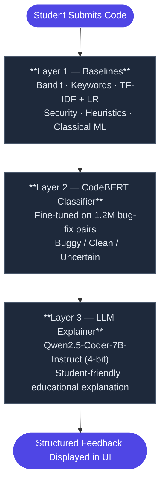

# AI-Powered Educational Code Analyzer

 An intelligent teaching assistant that helps Computer Science students identify bugs in their code and understand *why* those bugs occur not just that they exist.


## Table of Contents

- [Motivation](#motivation)
- [Overview](#overview)
- [System Architecture](#system-architecture)
- [Project Structure](#project-structure)
- [Results Summary](#results-summary)
- [Technologies Used](#technologies-used)
- [Installation & Setup](#installation--setup)
- [Author](#author)

---

## Motivation

Code review is a fundamental practice in software development, yet it remains a significant bottleneck especially in educational settings where students need timely, personalised feedback. Traditional static analysis tools can flag syntax errors and style violations, but they cannot explain *why* a bug occurs or how to avoid it in the future.

This project addresses that gap by combining three complementary techniques, rule-based static analysis, a fine-tuned deep learning classifier, and a large language model into a single system that not only detects bugs but teaches students about them.

The research question driving this work is:

 *Can a multi-layered analysis pipeline combining static analysis, transformer-based classification, and LLM-generated explanations provide effective, educational feedback for novice programmers?*

---

## Overview

This project combines automated code review with educational feedback. Rather than simply flagging errors, the system explains bugs in a student-friendly way covering the symptom, the root cause, the fix, and a mini-lesson to reinforce understanding.

### What It Does

A student pastes or uploads their code (Python or Java). The system runs it through a three-layer analysis pipeline and returns structured, educational feedback in the UI.

### Target Users

First and second year Computer Science students who want to understand their mistakes, not just fix them.

### Key Features

- Detects bugs and code quality issues using a combination of static analysis, classical machine learning, and deep learning techniques
- Explains findings in plain English, structured as a tutoring session
- Supports Python and Java
- Works directly in the browser no setup required for students

---

## System Architecture

The system is split into a **React frontend** and a **Flask backend**. When a student submits code, the backend runs three analysis layers in sequence and returns a combined result.

### Analysis Pipeline



### Layer 1 — Baselines (A, B, C)

The first layer runs three baseline approaches that serve as both analysis tools and reference points for evaluating CodeBERT:

- **Baseline A — Static Analysis (Bandit):** Scans code for security vulnerabilities and risky patterns such as `eval()` and `exec()`. Fast, deterministic, and requires no training.
- **Baseline B — Keyword Matching:** A simple heuristic approach that flags known risky constructs (e.g. `while True`, unsafe `input()`). Intentionally weak, included as a lower-bound reference.
- **Baseline C — TF-IDF + Logistic Regression:** A classical machine learning approach that converts code into TF-IDF feature vectors and trains a Logistic Regression classifier. Provides a strong non-deep-learning comparison.

### Layer 2 — CodeBERT Classifier

Runs a fine-tuned version of Microsoft's CodeBERT model, trained on over 1.2 million real-world bug-fix pairs. The model classifies each function as `buggy`, `clean`, or `uncertain`.

Large files are automatically split into individual functions using Python's AST module, so each function is analysed independently within CodeBERT's 512-token limit. The file-level result is determined by whether any function is classified as confidently buggy.

### Layer 3 — LLM Educational Explainer

Uses Qwen2.5-Coder-7B-Instruct (4-bit quantised) to generate a structured five-section explanation:

1. **Goal**: what the code is trying to do
2. **The Bug**: symptom, cause, and common misconception
3. **The Fix**: what to change and why
4. **Mini-Lesson**: a rule of thumb with a one-line example
5. **Quick Check**: a conceptual question to test understanding

The explainer was evaluated against two baselines to validate the prompt engineering approach:

- **Baseline 1: Template-Based:** Generates a structured explanation directly from the code diff without any LLM. Serves as a no-model lower bound.
- **Baseline 2: Zero-Shot LLM:** Uses the same Qwen model but with a minimal, unstructured prompt. No diff grounding or format enforcement.

The final explainer (with grounded diff injection and strict format enforcement) significantly outperforms both baselines in format compliance, factual accuracy, and explanation quality.

If no GPU is available (local development), the system falls back to a structured placeholder that still provides meaningful feedback based on the static analysis and CodeBERT outputs.

### Frontend

Built with React and Vite. It uses the Monaco Editor (the same editor used in VS Code) for code input, and renders the LLM explanation as formatted Markdown using `react-markdown`.

---

## Project Structure

```
yxa342/
├── flask/                              # Backend (Flask REST API)
│   ├── app.py                          # Main Flask application entry point
│   ├── requirements.txt                # Python dependencies
│   ├── data/                           # Datasets used by the backend
│   ├── models/
│   │   ├── codebert_config.py          # CodeBERT configuration
│   │   ├── baseline_c_tfidf_lr.pkl     # Trained Baseline C model (TF-IDF + LR)
│   │   ├── CodeBERT/
│   │   │   ├── classifier.py           # CodeBERT inference logic
│   │   │   ├── codebert_loader.py      # Model loading utilities
│   │   │   └── fine_tuned_model/       # Fine-tuned CodeBERT weights
│   │   ├── codebert_baselines/
│   │   │   ├── baseline.py             # Baselines A, B, C implementations
│   │   │   └── pre_trained_codebert_nf/    # Pre-trained (non-fine-tuned) model
│   │   └── llm/
│   │       ├── __init__.py
│   │       └── tutor.py                # LLM educational explainer module
│   ├── reports/                        # Generated analysis reports
│   ├── static/                         # Static assets
│   └── templates/                      # HTML templates
│
├── frontend/                           # Frontend (React + Vite)
│   ├── index.html                      # HTML entry point
│   ├── package.json                    # Node.js dependencies
│   ├── vite.config.js                  # Vite configuration
│   └── src/
│       ├── main.jsx                    # React entry point
│       ├── App.jsx                     # Main application component
│       ├── App.module.css              # Application styles
│       ├── index.css                   # Global styles
│       ├── components/                 # Reusable UI components
│       └── hooks/                      # Custom React hooks
│
├── training_modules/                   # Model training and evaluation scripts
│   ├── python/
│   │   ├── CodeBERT.py                 # CodeBERT fine-tuning script
│   │   ├── GraphCodeBERT.py            # GraphCodeBERT training script
│   │   ├── evaluate_codebert_final.py  # Final evaluation script
│   │   └── random/                     # Random baseline experiments
│   ├── java/                           # Java-specific training
│   └── csharp/                         # C#-specific training
│
├── educational_llm/                    # Educational LLM experiments
│   ├── run_explainer.py                # LLM explainer runner
│   ├── baselines/                      # LLM baseline comparisons
│   ├── data/                           # LLM experiment data
│   └── outputs/                        # Generated explanations
│
├── README.md                           # Project overview (this file)
├── WEEKLY_REPORT.md                    # Weekly progress reports
└── Final Year Project Proposal.pdf     # Original project proposal
```

---

## Results Summary

### CodeBERT Classification Performance (Python)

The fine-tuned CodeBERT model was evaluated on a held-out test set using a frozen threshold selected on the validation split. No test-time tuning was performed.

#### Training Dataset Composition

| Source             | Samples   |
|--------------------|-----------|
| CTSSB              | 814,416   |
| Defectors          | 202,804   |
| Synthetic          | ~183,000  |
| CTSSB Augmented    | 6,622     |
| PyVul              | 1,474     |
| **Total (deduplicated)** | **1,208,301** |

#### Python Evaluation Results

| Metric            | Pre-Trained (Baseline) | Fine-Tuned   | Improvement |
|-------------------|------------------------|--------------|-------------|
| Accuracy          | 51.51%                 | **67.29%**   | +15.78%     |
| Macro-F1          | 51.50%                 | **67.27%**   | +15.77%     |
| AUC               | 51.41%                 | **76.59%**   | +25.18%     |
| Average Precision | 51.10%                 | **77.55%**   | +26.45%     |
| Clean Recall      | 53.25%                 | **69.78%**   | +16.53%     |
| Buggy Recall      | 49.77%                 | **64.80%**   | +15.03%     |

The pre-trained model performs near-randomly (~51%), confirming that general-purpose code embeddings alone are insufficient for defect detection. Fine-tuning on the curated 1.2M-pair dataset yields substantial improvements across all metrics, validating the necessity of task-specific training.

### LLM Explainer Quality (100-Sample Evaluation)

| Metric                       | Result  |
|------------------------------|---------|
| Format compliance            | 100%    |
| High-quality explanations    | 93%     |
| Safe fallback (no corruption)| 7%      |
| Hallucinated diffs           | 0       |

---

## Technologies Used

### Backend

| Technology                 | Purpose                             |
|----------------------------|-------------------------------------|
| Python 3                   | Backend language                    |
| Flask                      | REST API server                     |
| PyTorch                    | Model inference                     |
| Transformers (HuggingFace) | CodeBERT + Qwen model loading       |
| Bandit                     | Security-focused static analysis    |                           
| scikit-learn               | Baseline ML models                  |

### Frontend

| Technology      | Purpose                              |
|-----------------|--------------------------------------|
| React 18        | UI framework                         |
| Vite            | Build tool                           |
| Monaco Editor   | Code input editor                    |
| react-markdown  | Markdown rendering for LLM output    |

### Models

| Model                               | Role                                 |
|--------------------------------------|--------------------------------------|
| `microsoft/codebert-base`            | Fine-tuned bug classifier            |
| `Qwen/Qwen2.5-Coder-7B-Instruct`    | Educational explanation generator    |

---

## Installation & Setup

### Prerequisites

- Python 3.10+
- Node.js 18+
- A CUDA-compatible GPU is recommended for the LLM explainer (the system works without one, but the LLM layer will use a structured fallback instead)

### 1. Clone the Repository

```bash
git clone git@git.cs.bham.ac.uk:projects-2025-26/yxa342.git
cd yxa342
```

### 2. Backend Setup

Install the Python dependencies:

```bash
pip install -r requirements.txt
```

Start the Flask server:

```bash
python app.py
```

The backend will run at `http://127.0.0.1:5001`.

### 3. Frontend Setup

Install the Node dependencies:

```bash
npm install
```

Start the development server:

```bash
npm run dev
```

The frontend will run at `http://localhost:5173`.

### 4. Using the Application

1. Open `http://localhost:5173` in your browser
2. Paste your Python or Java code into the editor, or upload a file
3. Click **Analyse**
4. Review the feedback in the panel on the right

---

## Author

**Yousef Aldali**-2720540 
**Supervisor: Dr. Abhirup Ghosh**

---

## Documentation

 - **[View Weekly Progress Report](./WEEKLY_REPORT.md)**
